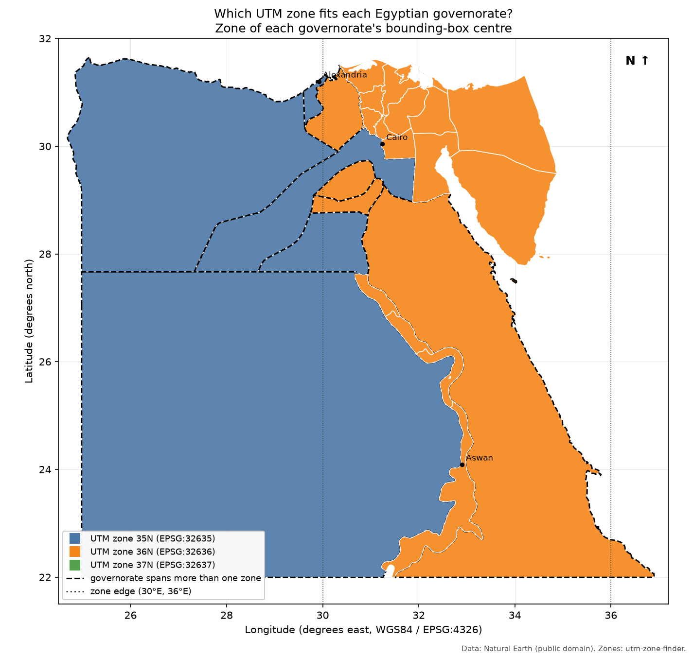

# Which UTM zone fits each Egyptian governorate?

**Question:** If you project Egypt's 27 governorates for metric work, which UTM zone (EPSG code) should each one use, and which of them cross a zone edge?

## Data

- File: `data/egypt_governorates.geojson` (27 features, about 108 KB).
- Source: Natural Earth, Admin 1 - States, Provinces, 1:10m, filtered to `adm0_a3 == "EGY"`.
  <https://raw.githubusercontent.com/nvkelso/natural-earth-vector/master/geojson/ne_10m_admin_1_states_provinces.geojson>
  (see <https://www.naturalearthdata.com/downloads/10m-cultural-vectors/10m-admin-1-states-provinces/>).
- License: public domain (<https://www.naturalearthdata.com/about/terms-of-use/>).
- Date fetched: 2026-11-15.
- Changes from the original: only the attributes `name`, `name_ar`, `iso_3166_2` and `type_en` were kept. Coordinates are kept exactly as published (no rounding or simplification); `map.geojson` carries the same vertices, only re-ordered where needed for RFC 7946 ring winding.
- Natural Earth draws the boundaries of its own cartographic choice; they are not survey-grade.

## Method

For every governorate (CRS: WGS84 lon/lat, EPSG:4326, degrees; x = longitude, y = latitude):

1. `bbox_from_geojson(feature)` gives the bounding box in degrees.
2. `zone_for_bbox(*bbox)` gives the zone of the box centre, with its EPSG code (326xx, WGS84 / UTM north).
3. `zones_spanned(*bbox)` lists every zone the box touches, checked at every zone edge inside the box.

No distances or areas are computed. Zones are 6 degrees wide: 35N covers 24-30 E, 36N 30-36 E, 37N 36-42 E.
The output polygons are written to `map.geojson` in EPSG:4326 with the zone as properties; ring winding is set to RFC 7946 (exterior counter-clockwise).

## Results

- 22 governorates map to UTM 36N (EPSG:32636) and 5 to UTM 35N (EPSG:32635); none has its box centre in 37N.
- 9 of 27 bounding boxes touch more than one zone. Eight cross 30 E (35N/36N): Alexandria, Giza, Minya, New Valley, Matruh, Beheira, Fayoum and Beni Suef. Red Sea crosses 36 E (36N/37N).
- Cairo (Al Qahirah, 31.22-31.94 E) lies wholly inside 36N, so EPSG:32636 is the natural choice there.
- New Valley (Al Wadi at Jadid) spans 24.98-32.93 E, almost 8 degrees: one UTM zone cannot serve it well, so distances in it would be distorted at the far edges.
- Note that "bounding-box centre" is not the same as "where most of the land is": Beheira, Fayoum and Beni Suef get 36N from their centre although their boxes reach into 35N.



## Files

- Web map: [index.html](index.html) (Leaflet with OpenStreetMap tiles; it loads `map.geojson`, so serve the folder, e.g. `python -m http.server` from `showcase/`, and open it in a browser)
- Notebook: [showcase.ipynb](showcase.ipynb) (outputs saved)
- Result data: [map.geojson](map.geojson)

## Rebuild

```bash
python showcase/make_showcase.py
```

Runs offline from `showcase/data/`. Needs matplotlib for `map.png`. The notebook is re-executed separately, for example
`python -m jupyter nbconvert --to notebook --execute --inplace showcase/showcase.ipynb`.
`tests/test_showcase.py` checks that `map.geojson` matches a fresh build.

Map credit: boundaries from Natural Earth; web map tiles (c) OpenStreetMap contributors.
